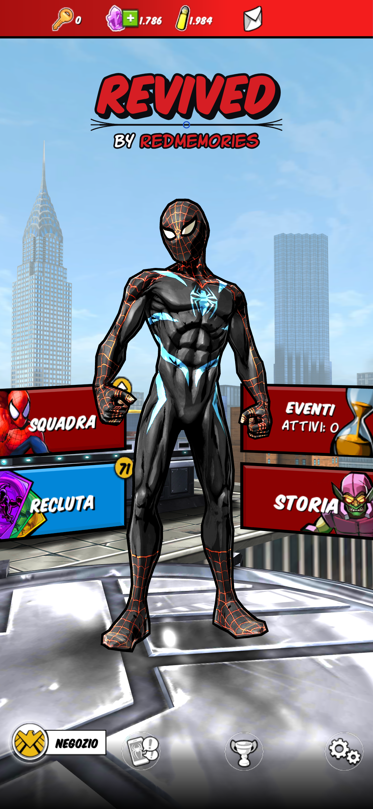
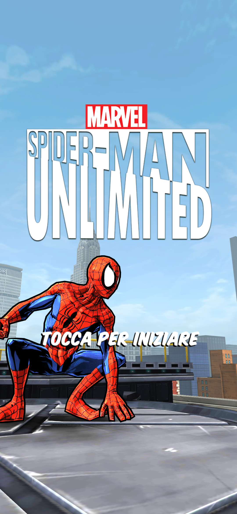
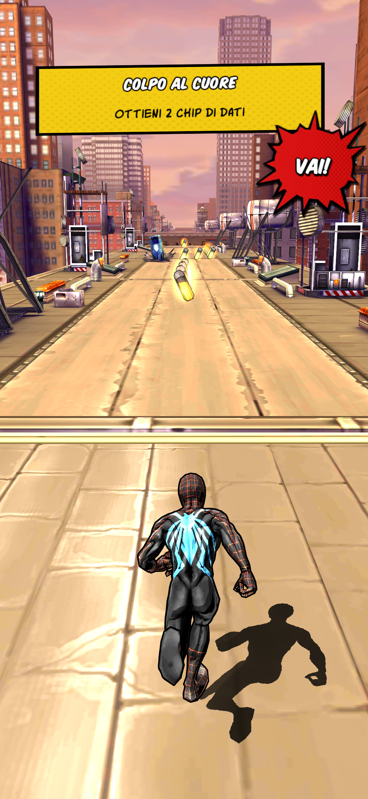
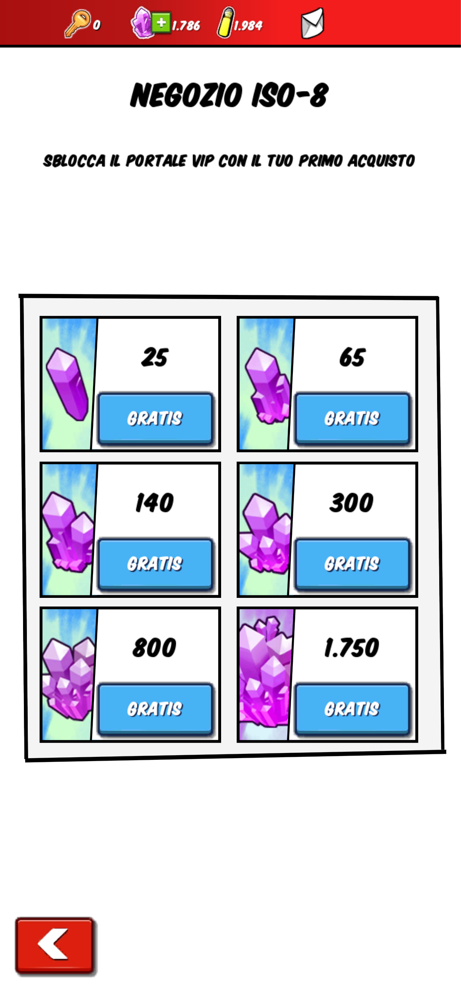
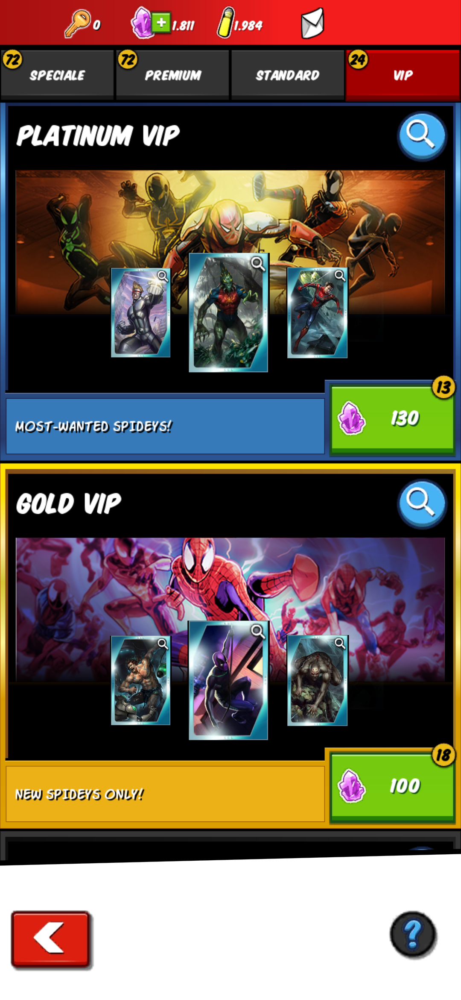

# Spider-Man Unlimited Revived

[](screenshots/main-menu.png)

> Spider-Man is a trademark of Marvel. The Spider-Man Unlimited mobile game is by Gameloft. This is a non-commercial fan project, not affiliated with Marvel, Disney or Gameloft. The game and its servers were shut down years ago. This repo is my private archive, please don't share the release files.

## What I did

I didn't remake the game and I didn't touch the gameplay. The runs, the story, the Spider-Men and their ranks are exactly the ones from the last version, 4.6.0 from December 2018.

Spider-Man Unlimited was an always-online game: it downloaded its data at the first launch, logged you in, and asked Gameloft's servers for almost everything. Those servers are gone, so the game couldn't even start. On top of that, on today's Android it crashed most of the time while loading, and when it didn't, Spider-Man was a pink wireframe. That one wasn't a server problem: the engine stored distances between its memory blocks in 32 bits, and modern Android spreads memory much further apart. I gave the engine one contiguous memory area, like the phones of its time, and the crashes and the pink Spider-Man are gone.

Then I rebuilt, on the phone, the parts that used to live on the server:

- recruiting from portals, ranking up and refilling stamina work offline, with the same odds and prices as the game data
- every Spider-Man that you could only get from events is in a recruit portal now, so the whole collection is reachable
- daily challenges and the daily login bonus work again, and they renew every day
- everything is saved on the phone

[](screenshots/title.png)

[](screenshots/run.png)

It also runs like a modern app: full screen on today's tall displays, edge to edge, and at 60 fps instead of the original 30.

The game is now fully offline, with no ads and no tracking, and it doesn't need any special permission. The buttons that sent you to services that don't exist anymore (Gameloft Connect, video ads, leaderboards, friends, customer care, privacy and terms pages) are gone. The old downloader is gone too: the game data is packed inside the APK, so there's nothing to download separately.

The real-money store still opens, but every ISO-8 pack is free: tap it and the crystals are yours. If you'd rather earn them, just play: rewards and prices in the game are the same as before. The first pack also unlocks the VIP portals, as the game always promised, and they cost ISO-8 like before.

[](screenshots/store.png)

[](screenshots/vip-portals.png)

When I publish a new version, a small notice appears on the main menu, and tapping it opens the release page. That check is the only thing the app does online, and only once a day.

**Not there yet:** time-limited events came from the server, so the EVENTS menu is empty for now. Their Spider-Men are already in the recruit portals; playing the events themselves from that menu is planned for an update.

## Install

1. Download the APK from **Releases**
2. Install it
3. Open it. The first launch takes a few seconds to unpack the game, after that it starts right away

No PC, no extra downloads, no account.

## Requirements

- 64-bit Android phone with Android 10 or newer
- about 3 GB of free space

I play it on a Galaxy S26 Ultra with Android 17. If you play on a different phone, let me know how it runs.

## Credits

Revived by **RedMemories**

Thanks to Doug Lea for dlmalloc, the memory allocator that keeps the engine's memory in one place.

Original game by Gameloft.

## ☕ Support my work

If you enjoy my projects and would like to support my work, you can send a tip in **USDC on the Polygon network**. Every project I create is and will always remain free, but any support is greatly appreciated and helps me keep working on new projects and improvements.

```
0x0e1C11ccA29E9D2AAa9384eE0d5464f4d079E61D
```

⚠️ Send only **USDC on Polygon** to this address: other tokens or networks could be lost.

Thank you for your support! ❤️
